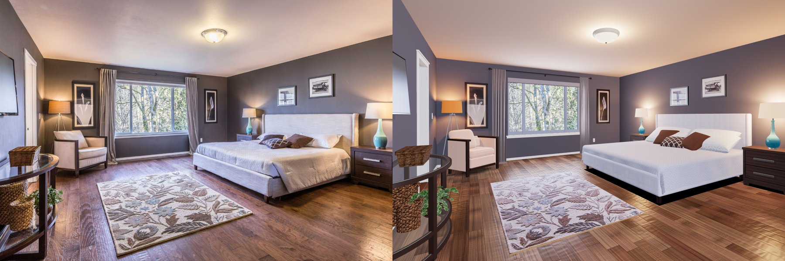

# Photo vs render

Each round, `tools/shoot.mjs` rendered Compare mode headlessly (Chromium, software WebGL) from the photo's calibrated camera. The photo and the render were then compared side by side, with a 50/50 blend and pixel colour samples.

**Photos covered: 1 of 1.** Only `photos/photo1.jpg` was supplied, so every round compares against it.

| Round 1, before | After round 1 | After round 2 | After round 3 |
|---|---|---|---|
|  |  |  |  |

(In each image the photo is on the left and the render on the right.)

## Round 1

Five critics (structure, bed wall, left side, window wall, lighting) listed 67 mismatches. Biggest ones, and what changed:

| Mismatch | Fix |
|---|---|
| The camera calibration was off. Room lines missed by up to 15 px, and the lower corners by 24 to 36 px (rug edge, nightstand feet) | Refitted on ten room lines: fx 1198 → 1073, camera 0.6 m closer to the window. Line fit went from 5.86 px RMS to 0.29 px. Every position in `layout.js` was re-derived, and the room is now 5.05 × 6.0 m |
| Lamp light on the walls had the wrong shape: narrow cones with hot discs on the ceiling | A wide, soft fan that starts at the shade top. The floor lamp's shade now casts shadows, so light no longer leaks sideways |
| Contact shadows were missing everywhere | Bug: the ceiling light's shadow bias was about 1 m (it scales with the shadow camera's 500 m far plane). Far plane set to 9 m. Dark contact patches added under the bed, nightstands and chair |
| Pillows looked like flat paper slabs | Plump pillows. The lattice pillow got the photo's finer pattern |
| Walls were too violet, the left wall too dark, the ceiling too bright | Paint colours sampled from the photo. Added the cool fill light from behind the photographer that the photo shows on the left wall and near floor |
| Curtains: too light and pink, too few folds, right panel 20 px off and hiding the outlet | Taupe, six narrow folds per panel, re-measured panel positions |
| The TV was a black slab, flush to the wall | Pale reflective screen, swivelled and tilted on its arm as in the photo |
| Headboard wings too deep, nightstand wood too dark, baskets too dark and red | Slimmer wings, lighter wood, re-balanced weave textures |

## Round 2

Measured against the photo after round 1 (photo vs render colour, 1500 px compare image):

| Spot | Photo | Render, start of round 2 | Render, end of round 2 |
|---|---|---|---|
| Near side of the bed | (144,126,127) | (211,213,225) | (185,187,204) |
| Ceiling centre | (204,183,167) | (225,214,207) | (217,196,181) |
| Coverlet top | (202,203,221) | (218,213,217) | (210,202,206) |
| Wall below window | (84,80,97) | (86,80,96) | (83,77,92) |
| Foreground floor | (143,103,85) | (159,115,88) | (136,91,65) |

Fixes:

- **The bed read as a white box.** The cool front fill hit its near side head-on. The fill now sits left of centre, so it still lights the left wall and near floor, and the quilt is a shade darker.
- **Ceiling too bright and neutral.** Warmer, darker beige paint.
- **The hallway behind the door showed as a box outside the room in Dollhouse.** It now hides with the ceiling.

## Round 3

A zoomed side-by-side pass over the round 2 result:

| Region | Photo | Render after round 2 | Fix |
|---|---|---|---|
| Floor | Dark walnut, long planks, soft sheen | Lighter, more orange, short planks reading as parquet, glossy streaks | Planks 0.9-2.4 m long (were 0.45-1.85), less saturated, roughness 0.32 → 0.42 |
| Ceiling light | Glowing frosted glass | Opaque matte dome | Dome glow doubled |
| Bedding | Cool lavender linen and coverlet | Warmer, rail the same white as the coverlet | Linen and quilt shifted toward the photo's blue |
| Walls near the lamps | Warm brown-grey | Slightly violet | Not changed (see below) |

Mouse look was also added to the verifier (`walk-look`): a real click takes the pointer lock and the view must turn. Headless Chromium sends no `movementX` with Playwright's mouse moves under a lock, so the check falls back to one motion event dispatched under the real lock, and says so in its result.

ROUND3_TABLE

## What still differs

- The photo's HDR processing squeezes local contrast. That's why the bed's near side is still brighter than the photo, and the wall under the TV darker (about L107 vs L172). One global exposure can't match both.
- At the foot of the bed, the photo's grey rail shows clearly under the coverlet. In the render the rail is close to the coverlet's colour, so the bed still reads as one pale block.
- The walls near the lamps are slightly more violet than the photo's warm grey; warming the paint would break the match under the window, where the photo is cool.
- The floor's scraped texture and exact plank layout differ from the photo's.
- The ceiling light glows now, but its rim reads as white plastic rather than clear glass and nickel.
- The calibration residual is under 4 px on room lines. The console and the chair's left post are still about 5 px off.
- From above in Dollhouse, a thin strip of white door trim still shows along the left wall's edge.
- The TV, door and window view are fitted to this one camera angle. With a second photo, the window view would show a little parallax.
